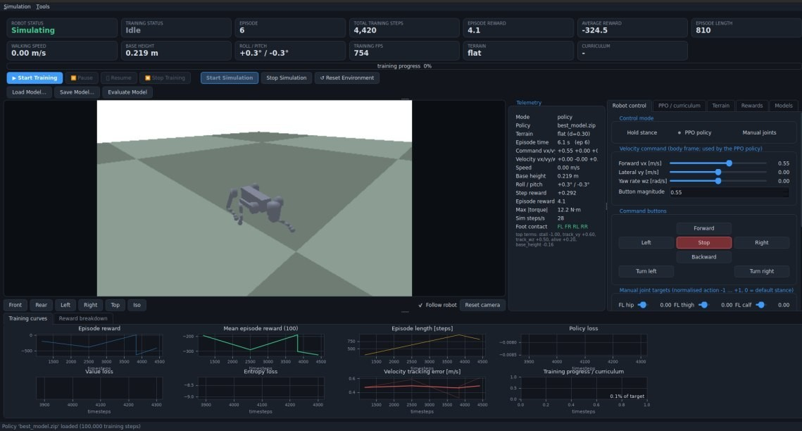

# Unitree Go2 – PyBullet & PPO Locomotion Lab

A modular reinforcement learning framework for training the **Unitree Go2 quadruped robot** to perform locomotion across different terrains using **Proximal Policy Optimization (PPO)**.

The project uses PyBullet for physics simulation, Stable-Baselines3 for reinforcement learning, and PySide6 for an interactive graphical interface with real-time monitoring, robot control, terrain generation, and model evaluation.

<p align="center">
  
</p>

## Features

- **Robot Simulation:** Loads the Unitree Go2 URDF model into PyBullet.
- **Reinforcement Learning:** PPO-based locomotion training using Stable-Baselines3.
- **PD Motor Control:** Torque-controlled actuators with joint position targets.
- **Terrain Generation:** Procedurally generated flat, uneven, stepping, stairs, slopes, rough, and obstacle terrains.
- **Domain Randomization:** Randomizes friction, mass, motor strength, sensor noise, and external disturbances.
- **Curriculum Learning:** Progressively increases task difficulty based on evaluation performance.
- **Interactive GUI:** PySide6 dashboard for simulation, training, and monitoring.
- **Model Management:** Save, load, resume, evaluate, and compare trained checkpoints.
- **Performance Evaluation:** Measures velocity tracking, stability, fall rate, power consumption, and terrain completion.

## Tech Stack

| Component | Technology |
|---|---|
| Programming Language | Python |
| Physics Simulation | PyBullet |
| Reinforcement Learning | PPO |
| RL Framework | Stable-Baselines3 |
| Deep Learning | PyTorch |
| Environment API | Gymnasium |
| GUI | PySide6 |
| Robot Description | URDF |
| Visualization | Matplotlib |
| Configuration | YAML |

## System Architecture

```text
                 Unitree Go2 Robot
                         |
                    URDF Loader
                         |
                  PyBullet Physics
                         |
                  Gymnasium Env
                         |
             Observation & Reward
                         |
                  PPO Algorithm
                         |
                Trained Policy
                         |
                 PD Controller
                         |
                  Joint Torques
                         |
                  Robot Motion
                         |
               Evaluation System
```

## Project Structure

```text
go2_rl_simulator/
│
├── assets/
│   ├── go2_description.urdf
│   └── dae/
│
├── environment/
│   ├── go2_env.py
│   ├── observation.py
│   ├── reward.py
│   ├── termination.py
│   └── domain_randomization.py
│
├── simulation/
│   ├── robot_loader.py
│   ├── robot_controller.py
│   ├── pybullet_sim.py
│   └── sim_worker.py
│
├── terrain/
│   └── terrain_generator.py
│
├── rl/
│   ├── ppo_trainer.py
│   ├── callbacks.py
│   ├── curriculum.py
│   ├── evaluation.py
│   └── model_manager.py
│
├── gui/
│   ├── main_window.py
│   ├── dashboard.py
│   ├── simulation_view.py
│   ├── training_panel.py
│   ├── control_panel.py
│   └── analytics_panel.py
│
├── tests/
├── models/
├── checkpoints/
├── logs/
├── results/
│
├── config.yaml
├── requirements.txt
├── main.py
└── README.md
```

## Installation

### 1. Clone the repository

```bash
git clone <YOUR_GITHUB_REPOSITORY_URL>
cd go2_rl_simulator
```

### 2. Create a virtual environment

```bash
python3 -m venv .venv
source .venv/bin/activate
```

For Windows:

```bash
.venv\Scripts\activate
```

### 3. Install dependencies

```bash
pip install -r requirements.txt
```

## Running the Project

### Launch GUI

```bash
python main.py
```

### Validate Robot Model

```bash
python main.py --validate
```

### Start PPO Training

```bash
python main.py --headless --train
```

### Train with Multiple Environments

```bash
python main.py --headless --train \
    --timesteps 30000000 \
    --n-envs 8 \
    --seed 1
```

### Resume Training

```bash
python main.py --headless --train \
    --resume checkpoints/ckpt_0000500000.zip \
    --timesteps 3000000
```

### Evaluate a Trained Model

```bash
python main.py --evaluate \
    --model models/best_model.zip
```

### Run Inference

```bash
python main.py --infer \
    --model models/best_model.zip \
    --command 0.5 0 0
```

### Monitor Training

```bash
tensorboard --logdir logs/tensorboard
```

## Reinforcement Learning

The project uses **Proximal Policy Optimization (PPO)**, an actor-critic reinforcement learning algorithm.

The policy learns to control 12 actuated joints using observations from the robot's simulated sensors.

**Observation Space (52 dimensions):**
- Base linear velocity
- Base angular velocity
- Projected gravity
- Desired velocity commands
- Joint positions and velocities
- Previous actions
- Foot contact information

**Action Space (12 dimensions):**

Continuous joint position targets normalized between -1 and +1.

### Reward Design

The reward function considers:

- Linear and angular velocity tracking
- Robot stability and orientation
- Foot contact and swing-phase rewards
- Joint velocity and acceleration penalties
- Energy consumption
- Foot slipping
- Body contact and self-collision
- Movement and stall penalties

## Curriculum Learning

Training difficulty increases progressively through five stages:

| Stage | Objective |
|---|---|
| 1 | Standing balance |
| 2 | Forward and backward locomotion |
| 3 | Multi-directional walking and turning |
| 4 | Uneven terrain and obstacle adaptation |
| 5 | Robust locomotion across mixed terrains |

Progression is controlled by evaluation metrics rather than training reward alone.

## Evaluation Metrics

The evaluation system measures:

- Average episode reward
- Distance travelled
- Mean velocity
- Velocity tracking error
- Fall rate
- Completion rate
- Robot tilt
- Energy consumption
- Foot slip
- Terrain completion rate

Models receive a **PASS / NOT PASSED** verdict based on predefined evaluation thresholds.

## Testing

Run the test suite:

```bash
pytest tests -q
```

The project test suite covers robot loading, joint limits, physics, environment behaviour, terrain generation, PPO training, checkpoint management, evaluation, and GUI responsiveness.

## Training Status

The training pipeline and evaluation system have been tested.

An initial single-CPU training experiment achieved standing balance, but the 700K-step checkpoint did not yet demonstrate successful walking. Therefore, a successfully learned walking policy is not claimed.

Longer training runs with multiple environments are recommended.

## Future Improvements

- Improve PPO locomotion performance.
- Train robust policies across randomized terrains.
- Experiment with SAC and other reinforcement learning algorithms.
- Introduce additional sensor observations.
- Improve sim-to-real transfer capabilities.
- Integrate with ROS 2 for hardware deployment.

## Acknowledgements

- [Unitree Robotics](https://www.unitree.com/)
- [PyBullet](https://pybullet.org/)
- [Stable-Baselines3](https://stable-baselines3.readthedocs.io/)
- [Gymnasium](https://gymnasium.farama.org/)
- [PyTorch](https://pytorch.org/)

---

<p align="center">
  Developed as a reinforcement learning and quadruped locomotion simulation project.
</p>
